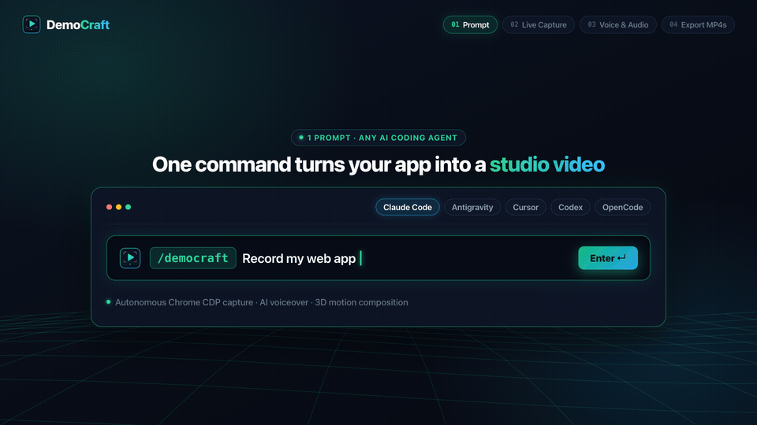

<p align="center">
  
</p>

<h1 align="center">DemoCraft</h1>

<p align="center">
  <strong>AI Agent Skill for Autonomous Web App Ads, Product Demos &amp; Video Tutorials</strong>
</p>

<p align="center">
  An open <code>SKILL.md</code> skill for <strong>Claude Code, Google Antigravity, OpenAI Codex, Cursor, and OpenCode</strong> that lets your AI agent open your live web app, navigate autonomously (clicks, tabs, modals, smooth scroll, drag-and-drop), capture 2× Retina screenshots &amp; live screen recordings, generate AI voiceover + auto-ducked music + SFX, animate in 3D, and export ready-to-post MP4 ads, product demos, and tutorials (clean or subtitled) — with <strong>zero <code>npx</code>, zero <code>node_modules</code>, and zero global installs</strong>.
</p>

<p align="center">
  <a href="https://github.com/calavraian/democraft/releases"></a>
  <a href="./LICENSE"></a>
  
  
  
</p>

<p align="center">
  
</p>

---

## What Your AI Agent Does Autonomously

Install DemoCraft once, then simply ask your AI coding agent for an ad, demo, or walkthrough. DemoCraft handles the full production pipeline end-to-end:

1. **Inspects Your Real App:** Reads your README, routes, UI components, design tokens, and brand logos so every claim and color is grounded in real code — without modifying your project or ever reading `.env`/secrets.
2. **Navigates & Records Your Running Web App:** Connects to your existing Chrome/Brave/Edge via Chrome DevTools Protocol (zero Playwright, zero `npx`) to click buttons, switch tabs, open modals, sign in safely via `value_env`, capture **2× Retina screenshots** with normalized highlight coordinates, and selectively record smooth real scrolling (`record_scroll`) or live drag-and-drop (`record_drag`).
3. **Scripts, Voices & Mixes 3-Layer Audio:** Writes a paced storyboard timed to actual spoken duration, generates voiceover with **Google Gemini, OpenAI, ElevenLabs, `$0` offline Kokoro, or BYO audio** (or captions-only), and mixes auto-ducked music beds + **100% CC0 public-domain SFX**.
4. **Animates in 3D & Audits Every Scene Visually:** Composes deterministic HTML/CSS 3D motion over selectable 3D Canvas backgrounds, captures QA stills with safe-zone overlays to verify contrast and layout before rendering, and lets you export **with an on-screen Caption Bar or completely clean without subtitles** (simply omit `--captions`).
5. **Exports Ready-to-Post Deliverables:** Renders crisp `H.264 yuv420p` MP4s in **landscape (`16:9`)**, **vertical (`9:16` Reels/TikTok/Shorts)**, or **square (`1:1`)**, bakes the strongest settled frame onto Frame 0 (`poster.jpg`), writes `.srt` subtitles + grounded `share-copy.txt`, and cleans up heavy temporary frames automatically (`--clean-work keep-editable`).

---

## What You Can Build (Just Prompt Your Agent)

Once installed, prompt your AI agent in plain English (or invoke `/democraft`):

- **SaaS Commercial / Launch Ad (Clean Video, No Subtitles)**
  > *"Create a 30-second landscape 16:9 commercial ad for my web app running at `http://127.0.0.1:3000`. Open the dashboard, click into the analytics modal, voice it with Gemini over `modern-clean` music, and export a clean MP4 without on-screen subtitles (keep `.srt` separate)."*

- **Vertical `9:16` Social Reel / TikTok / YouTube Short**
  > *"Record a 25-second vertical 9:16 product demo for Reels/TikTok highlighting our live drag-and-drop workflow at `localhost:3000`. Use the `orbital-rings` 3D background, captions inside vertical safe zones, and free offline Kokoro voiceover."*

- **Step-by-Step Feature Tutorial (`tutorial` mode)**
  > *"Make a calm 90-second feature tutorial walking new users through creating a project and exporting a report on `localhost:3000`. Include smooth scroll capture, short `freeze_s` teaching pauses on key steps, and `ambient-calm` background music."*

- **Zero-Key Square `1:1` Product Teaser (LinkedIn / X)**
  > *"Generate a 20-second square 1:1 mute-friendly launch teaser from this repo with on-screen captions, `soft-aurora-mesh` 3D backdrop, and `harmonic-simple` music — no API keys needed."*

DemoCraft always probes your environment first, runs a short preflight interview for any unspecified preferences (format, voice provider, 3D backdrop, music mood, output folder), and keeps your API keys out of chat.

---

## Why DemoCraft?

- **Zero Bloat, Clean Disk Footprint:** Core pipeline runs on **Python 3.10+ stdlib** (~720 KB for scripts and bundled CC0 SFX) with zero `npx`, zero `node_modules`, and zero global installs. Uses your existing Chromium browser (`Chrome`, `Brave`, `Edge`, or `Chromium`), encodes via `ffmpeg` / `uv` / `docker`, and automatically prunes raw frames and derived WAVs (`--clean-work keep-editable` keeps a compact ~5–8 MB editable workspace; `--clean-work all` removes `work/` completely).
- **Two Editorial Modes:**
  - **`promo`** (`15–35s` target, `45s` soft cap + `5s` grace): crisp commercial ads & feature spotlights.
  - **`tutorial`** (`45–120s` target, `150s` soft cap + `10s` grace): calm step-by-step walkthroughs with optional `freeze_s` teaching pauses.
- **Hybrid Live Web Capture (Chrome CDP):** Declarative `flow.json` captures 2× Retina step screenshots with scene-matched highlight colors (zero rainbow clashes), smooth real scroll sequences (`record_scroll`), and selective live drag-and-drop recordings (`record_drag`) for Kanban boards, tactical boards, canvas editors, and sliders — all inside a disposable ephemeral Chrome profile.
- **3-Layer Audio & Multi-Provider Voiceover:**
  - **Music Beds:** 4 built-in royalty-free procedural moods (`ambient-calm`, `harmonic-simple`, `modern-clean`, `tech-spectacular`) synthesized ephemerally on demand + BYO track support (`--music`).
  - **SFX:** Curated **100% CC0 Public Domain** UI/impact/typing library (zero attribution required) + inline synthesized effects (`synth:<preset>`).
  - **Pluggable Voiceover:** **Google Gemini**, **OpenAI**, **ElevenLabs** *(with automatic free-tier fallback)*, **`$0` offline Kokoro**, **BYO narration**, or **captions-only** — with automatic FFmpeg sidechain music ducking under speech.
- **5 Selectable 3D Canvas Backgrounds:** `wireframe-wave`, `floating-polyhedra`, `orbital-rings`, `depth-grid-particles`, `soft-aurora-mesh`, or `none`.
- **Clean or Subtitled Social-Ready Export:** `landscape` (`1920×1080`), `vertical` (`1080×1920` with Reels/TikTok/Shorts safe-zone QA), or `square` (`1080×1080`) MP4, baked **Frame-0 poster (`poster.jpg`)**, optional multi-language **Caption Bar** (omit `--captions` for clean video) + `.srt` sidecars, and grounded **`share-copy.txt`**.

---

## Prerequisites

- **Python 3.10+** (standard library only for the core workflow)
- **Chromium-based browser** already installed (`Google Chrome`, `Brave`, `Edge`, or `Chromium`)
- **One FFmpeg runner:** `ffmpeg` on `PATH`, [`uv`](https://docs.astral.sh/uv/) *(recommended — zero global installs)*, or `docker`

Verify your environment without installing anything:
```bash
python3 scripts/probe.py
```

---

## Installation (Pick Your Preferred Method)

Modern `SKILL.md` agents (**Google Antigravity, Claude Code, OpenAI Codex, Cursor, OpenCode**) automatically discover any folder containing `SKILL.md` inside their skills directory — no manual config registry required.

### Option A: Install with Your AI Agent (1 Prompt — Zero Manual Commands)

Simply paste this prompt into **Claude Code, Google Antigravity, OpenAI Codex, Cursor, or OpenCode**:

> *"Install the DemoCraft skill from `https://github.com/calavraian/democraft.git` following its README instructions, register it in my skills directory, and run `scripts/probe.py` to confirm my environment is ready."*

<details>
<summary><strong>Agent Installation Protocol (Machine-Readable Steps for AI Agents)</strong></summary>

1. Clone `https://github.com/calavraian/democraft.git` into a persistent local directory (or directly into your agent's skills directory).
2. Run the stdlib registrar (zero `npx`, zero pip installs):
   ```bash
   python3 scripts/install.py --agent auto
   ```
   *(Pass `--agent antigravity`, `--agent claude`, `--agent codex`, `--agent cursor`, `--agent all`, or `--project <repo>` as appropriate; add `--dry-run` first if you want to preview paths.)*
3. Verify local capabilities without installing global packages or reading secrets:
   ```bash
   python3 scripts/probe.py --json
   ```
4. Report registration path + readiness (`core_ready`, `browser_path`, `ffmpeg_strategy`, `available_voice_providers`). Never ask the user to paste API keys in chat — point them to `assets/templates/democraft.env.example` if they later want cloud TTS.

</details>

### Option B: One-Command CLI Installer (Auto-Detects All Your Agents)

Clone once and let `scripts/install.py` register DemoCraft across every installed agent (`--symlink` tracks `git pull`; use `--mode copy` for a standalone copy):

```bash
git clone https://github.com/calavraian/democraft.git ~/.local/share/democraft
python3 ~/.local/share/democraft/scripts/install.py --agent auto
```

Useful installer flags:
- `--dry-run` — preview target directories without touching disk
- `--agent antigravity|claude|codex|cursor|all` — target specific agent(s)
- `--project /path/to/repo` — install project-locally in `.agents/skills/democraft`
- `--uninstall` — cleanly unregister without deleting the cloned repo

### Option C: Direct `git clone` per Agent

```bash
# Google Antigravity
git clone https://github.com/calavraian/democraft.git ~/.gemini/config/skills/democraft

# Claude Code
git clone https://github.com/calavraian/democraft.git ~/.claude/skills/democraft

# OpenAI Codex
git clone https://github.com/calavraian/democraft.git ~/.codex/skills/democraft

# Cursor / OpenCode (user-level or project-local .agents/skills/democraft)
git clone https://github.com/calavraian/democraft.git ~/.agents/skills/democraft
```

---

## Optional Voiceover Providers & Safe API Key Setup

You **do not need any API key** to use DemoCraft — captions-only exports, BYO audio (`--voice-file`), and offline `Kokoro` TTS all work for **`$0`**.

If you want expressive cloud voiceover, DemoCraft supports:

| Provider | Env Variable | Notes |
| :--- | :--- | :--- |
| **Google Gemini** | `GEMINI_API_KEY` | Expressive commercial & tutorial styles in ES/EN (`gemini-3.8-flash-tts`) |
| **OpenAI** | `OPENAI_API_KEY` | Expressive tone directives (`gpt-4o-mini-tts`), pure stdlib REST |
| **ElevenLabs** | `ELEVENLABS_API_KEY` *(+ optional `ELEVENLABS_VOICE_ID`)* | Studio & custom voices (`eleven_multilingual_v2`); auto-falls back to a free-tier premade voice if a library voice requires a paid plan |
| **Kokoro (Offline)** | *(none — `$0`)* | Automatic local offline fallback (`kokoro-onnx`) |
| **BYO / Mute** | *(none — `$0`)* | Bring your own audio (`--voice-file`) or render captions-only |

*(Note: Anthropic / Claude does not provide a native voice TTS API; Claude Code users can pair DemoCraft with Gemini, OpenAI, ElevenLabs, free offline Kokoro, or BYO audio.)*

### Safe Key Handling (Never Paste Keys in Chat)

Copy [`assets/templates/democraft.env.example`](./assets/templates/democraft.env.example) into a **gitignored** `.env.local` file (`chmod 600 .env.local`) and uncomment **only** the provider you want:

```dotenv
# Save in a gitignored .env.local (never commit, never paste in chat)
GEMINI_API_KEY=AIzaSy_YOUR_KEY_HERE
# OPENAI_API_KEY=sk-proj-YOUR_KEY_HERE
# ELEVENLABS_API_KEY=sk_YOUR_KEY_HERE
# ELEVENLABS_VOICE_ID=JBFqnCBsd6RMkjVDRZzb
```

Then pass `--env-file /path/to/.env.local` to `probe.py` and `voice_router.py` — keys are loaded strictly in process memory and never logged or read into chat context.

---

## Running Unit Tests

```bash
pytest tests -v
```

---

## License

- Code, scripts, templates, and documentation: **MIT License** ([LICENSE](./LICENSE))
- Bundled sound effects (`assets/audio/sfx/`): **CC0 1.0 Public Domain** ([assets/audio/LICENSE-CC0.md](./assets/audio/LICENSE-CC0.md))
